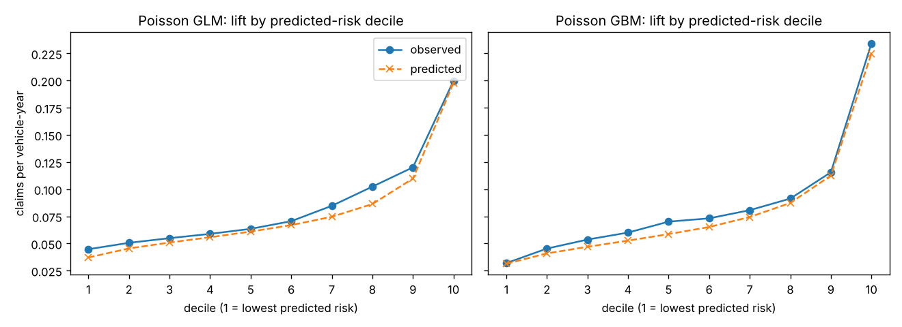

# motor-frequency-toolkit

A reusable Python toolkit for **motor claim-frequency modelling**: from raw policy data to a
model comparison, a feature-selection report and segment-level monitoring, with a human
approval gate before any model is promoted.

> **Data and scope.** Uses the public French motor dataset *freMTPL2freq* from OpenML (678,013 policies).
> It covers all claim types and has no dates, so **time periods and the emerging-risk shift are
> simulated and illustrative**. The aim is to show the approach and the engineering, not real results.

## Why I built this

I wanted to work through a few questions that come up whenever a pricing team builds or rebuilds a frequency model: how to choose rating factors with evidence, how to know a model will still hold up on future data, and how to turn the repeated notebook steps into a tool the whole team can reuse.

This toolkit takes motor policy data, checks it, compares a GLM with a gradient-boosted model, reports which features actually help, and flags when a segment starts drifting. The part I care most about is that it's reusable and tested, and that it stops before promoting a new model until a person signs off.

## Quick start

```bash
python -m venv .venv
.venv\Scripts\activate          # Windows  (Mac/Linux: source .venv/bin/activate)
pip install -e ".[dev]"
python -m motorfreq run         # downloads data, runs everything, writes reports/
python -m motorfreq benchmark   # loop vs vectorised pandas, string vs categorical memory
pytest -q                       # 12 tests
```

All settings are in `configs/default.yaml`.

## What it does

| Step | Module | Question it answers |
| --- | --- | --- |
| Load and clean | `data.py` | Claims per **vehicle-year**: frequency = claims ÷ exposure (insured time) |
| Quality checks | `validate.py` | Is the data safe to model? (missing values, exposure in (0, 1], claims ≥ 0) |
| Features | `features.py` | How should 22 regions be grouped so sparse areas aren't over-trusted? |
| Models | `models.py` | Poisson GLM (champion) vs Poisson GBM (challenger), weighted by exposure |
| Evaluation | `evaluate.py` | Fit (Poisson deviance), calibration (O/E) and risk separation (lift) |
| Feature selection | `feature_selection.py` | Which rating factors help, which overlap, which are unstable? |
| Monitoring | `monitor.py` | Which segments are drifting away from predictions? |
| Pipeline | `pipeline.py` | Runs it all; **recommends** a model but waits for a named approval |
| Benchmark | `benchmark.py` | How much do vectorised pandas and categorical dtypes save at portfolio scale? |

## Results (illustrative)

From `python -m motorfreq run` with the default config (OpenML data; overall frequency 0.104 claims per vehicle-year).

**Champion vs challenger**, trained on periods 1–3, tested on period 4:

| Model | Poisson deviance | O/E | Lift (top ÷ bottom decile) |
| --- | --- | --- | --- |
| Poisson GLM | 0.6424 | 1.133 | 7.96× |
| Poisson GBM | 0.6281 | 1.122 | 9.55× |

The GBM fits better and separates risk more sharply. O/E is above 1 for both because the test period
contains the simulated risk increase, which no model trained on earlier data can know about.



**Why time-based validation matters.** One vehicle segment (brand B12) gets a simulated +60%
frequency rise in the latest period, standing in for something like a new theft method:

| Validation | Segment O/E |
| --- | --- |
| Train on earlier periods, test on the latest | **1.56**: the shift is visible |
| Random 75/25 split | **1.05**: the shift is hidden |

A random split mixes old and new data, so it can make a stale model look fine.

**Location grouping.** Credibility-weighted grouping of 22 regions into 5 bands matches the fit of the
raw regions (deviance 0.6424 vs 0.6421) with slightly better lift (7.96× vs 7.91×), and improves lift
over leaving region out (7.79×).

**Feature selection** (`reports/feature_selection.csv`) combines three views per feature:
how much validation deviance worsens without it, how strongly frequency varies across its values,
and how stable its effect is over time. It flags **VehBrand as unstable** (the feature affected by the
simulated shift) even though it still helps the model, and shows that **Area, Density and the region
groups** each add little on their own because they carry overlapping location information.

**Monitoring** (`reports/monitoring.csv`) raises an alert for B12 (O/E 1.56 against a 1.2 threshold).

**Efficiency** (`python -m motorfreq benchmark`, 678,013 policies). Computing exposure-weighted
one-way frequency tables for four rating factors:

| Method | Time |
| --- | --- |
| Row-by-row Python loop | 0.442 s |
| Vectorised pandas groupby | 0.149 s |
| Vectorised groupby on categorical columns | **0.041 s (11× faster)** |

All three give identical results. Storing the text columns as categoricals cuts their memory from
142.9 MB to 2.7 MB (53× smaller). Small per table, but these steps run many times across features,
segments and model iterations.

## What I learned

The result that surprised me most was the validation one. When I added a shift to one vehicle segment, a random train/test split almost completely hid it (O/E 1.05), while testing on a later period caught it straight away (1.56). I'd always known time-based splits were "better", but seeing a random split make a stale model look fine made it click. The other surprise was how much plain pandas choices matter at this scale: switching text columns to categoricals made the same calculation 11× faster and used 53× less memory.

## Approval gate

The pipeline writes `reports/decision.json` with `"status": "awaiting_approval"`. Nothing is promoted
automatically. A reviewer records approval explicitly:

```bash
python -m motorfreq approve --by "Reviewer Name"
```

## Engineering

- Installable package (`pyproject.toml`), configuration in YAML, no hard-coded settings
- 12 `pytest` tests on synthetic data (fast, no download), run on every push by GitHub Actions
- Training-only fitting of groupings to avoid leakage into the test period

## Next steps

- Real policy dates and claim development (reporting delays) instead of simulated periods
- SHAP explanations for the GBM, and fairness checks for location features
- Severity modelling alongside frequency
