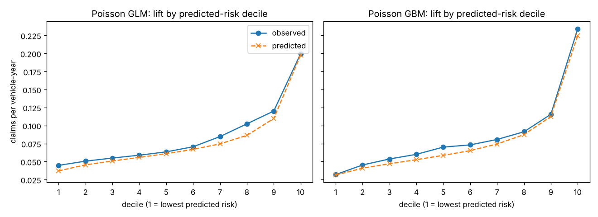

# Model and feature report

_Public French motor data (freMTPL2). Periods and drift are simulated: illustrative only._

- Policies: 677,991
- Overall frequency: 0.0754 claims per vehicle-year

## Champion vs challenger (tested on a later period)

| Model | Poisson deviance | O/E | Lift (top/bottom decile) |
| --- | --- | --- | --- |
| GLM | 0.4931 | 1.086 | 4.47x |
| GBM | 0.4825 | 1.080 | 7.34x |

## Why time-based validation

Segment VehBrand=B12 has a simulated risk increase in the latest period.

- Time-based split: segment O/E = **1.54** (the shift is visible)
- Random split: segment O/E = **0.95** (the shift is hidden)

## Location grouping

| Location feature | Poisson deviance | Lift |
| --- | --- | --- |
| grouped regions (5 bands) | 0.49308 | 4.47x |
| raw Region (22 levels) | 0.49287 | 4.23x |
| without region (Area and Density only) | 0.49313 | 4.47x |

## Feature selection

| feature    |   deviance_increase_when_dropped |   one_way_spread |   stability_ratio | recommendation             |
|:-----------|---------------------------------:|-----------------:|------------------:|:---------------------------|
| BonusMalus |                           0.0123 |           3.4053 |            1.0494 | keep                       |
| DrivAge    |                           0.0014 |           1.9569 |            1.0744 | keep                       |
| VehAge     |                           0.0008 |           1.495  |            1.2661 | keep                       |
| VehPower   |                           0.0003 |           1.1615 |            1.1557 | keep                       |
| VehGas     |                           0.0003 |           1.1344 |            1.0098 | keep                       |
| Area       |                           0.0001 |           1.7863 |            1.0442 | keep                       |
| AreaGroup  |                           0.0001 |           1.4144 |            1.2128 | keep                       |
| Density    |                          -0.0001 |           1.9132 |            1.0683 | candidate to drop or merge |
| VehBrand   |                          -0.0015 |           1.672  |            1.4171 | review: unstable over time |

## Monitoring (segment O/E, latest period)

| VehBrand   |   exposure |   observed |   expected |    oe | alert   |
|:-----------|-----------:|-----------:|-----------:|------:|:--------|
| B12        |   16216.2  |       1630 |   1058.23  | 1.54  | True    |
| B5         |    4950.7  |        447 |    396.848 | 1.126 | False   |
| B13        |    1671.92 |        144 |    129.412 | 1.113 | False   |
| B3         |    7104.33 |        637 |    591.152 | 1.078 | False   |
| B4         |    3508.44 |        286 |    277.605 | 1.03  | False   |
| B11        |    1742.96 |        169 |    164.541 | 1.027 | False   |
| B10        |    2374.08 |        194 |    190.898 | 1.016 | False   |
| B2         |   23637.6  |       1671 |   1712.12  | 0.976 | False   |
| B1         |   23665.3  |       1653 |   1715.04  | 0.964 | False   |
| B6         |    3978.99 |        292 |    325.985 | 0.896 | False   |

Alerts: B12

## Decision

Recommendation: **promote challenger**. Status: **awaiting_approval** (promotion requires a named reviewer: `python -m motorfreq approve --by "Name"`).